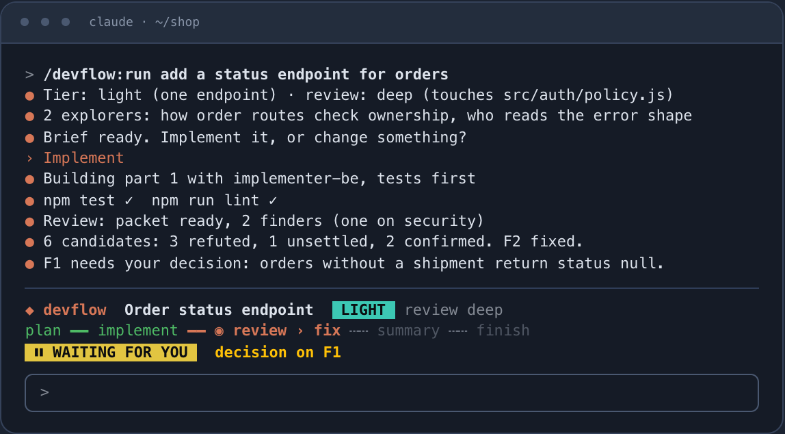
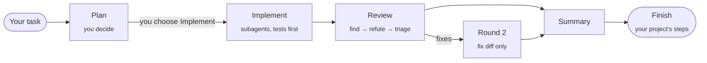
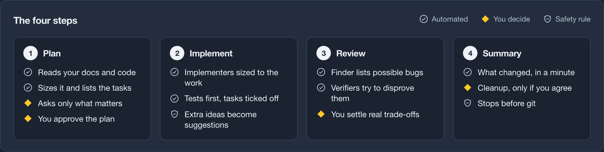
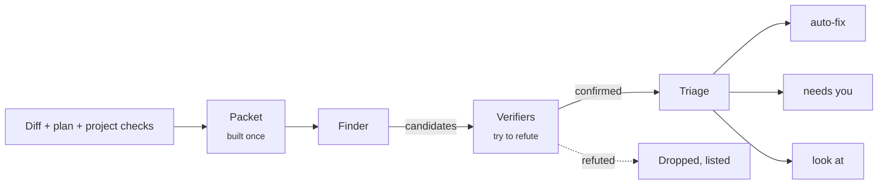
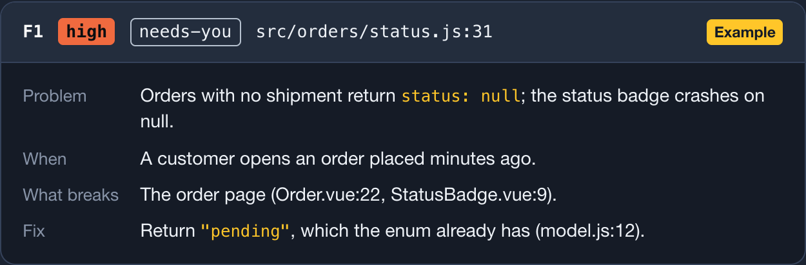
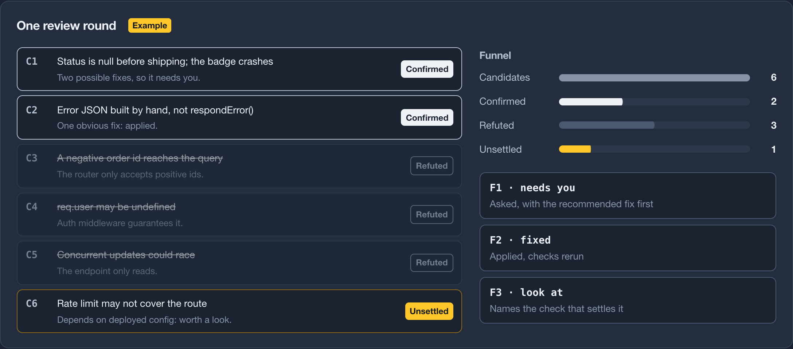
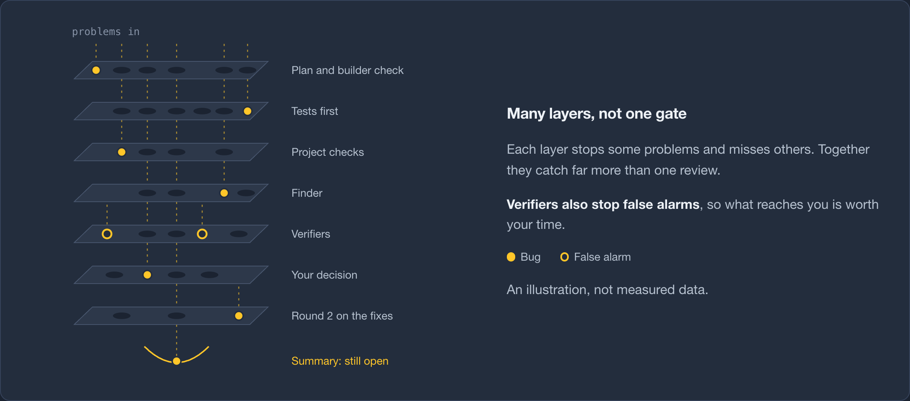
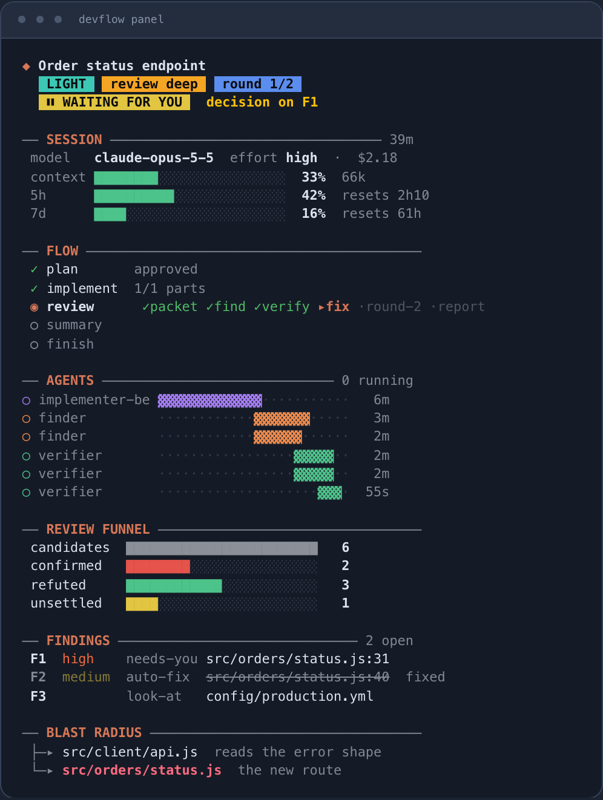

<div align="center">

# ◆ devflow

**Plan it with you. Build it with subagents. Review it like a skeptic.**

A Claude Code plugin that takes a task from request to a reviewed change, and spends effort where it buys reliability.

[](#install)
[](LICENSE)


</div>

---

AI writes code faster than anyone can review it. So we skim, we trust, and the bug ships. Or we review every line, burn out, and stop using the agent.

**devflow is the middle path.** You make the decisions that matter: what to build, the trade-offs, what to accept. The machine does the reading, building and checking, and it shows you only what needs your eyes.

```text
/devflow:run add a status endpoint for orders
```


<sub>The band above the prompt, recreated from the mod's rendering code with example data.</sub>

## Why devflow

- 🎯 **It sizes itself to the task.** A typo stays a typo: no plan, no agents. A new feature gets a design plan, tests first and a deep review. You don't pay for a full process on a five-minute change.
- 🧭 **Planning that respects your time.** It asks only what changes what gets built, in batched rounds with a recommended answer for each, and asks nothing when the task is clear. You read a 15-line brief, not a wall of text.
- 🔬 **A review that's allowed to say "nothing's wrong".** Every finding needs a real failure scenario with `file:line` evidence, and a separate verifier tries to refute it before you ever see it. Nitpicks and "this could theoretically…" are dropped.
- 🏗️ **It builds your way.** Your `CLAUDE.md`, docs, architecture and conventions win over its own rules. Better ideas arrive as suggestions; nothing outside the task is touched without your approval.
- 📺 **You can see what it's doing.** A live band and panel inside Claude Code show the phase, every running agent, the review funnel and what's waiting for you.
- 🛟 **Safe by default.** It never commits or pushes, and it never deletes its notes without asking.

## Install

devflow is a Claude Code plugin. Its repository is also its own marketplace, so installing it takes two commands.

**From GitHub, inside Claude Code:**

```text
/plugin marketplace add robo311/devflow
/plugin install devflow@devflow
```

**From GitHub, in a terminal:**

```bash
claude plugin install devflow --marketplace robo311/devflow
```

**From a local clone** (handy if you want to tweak the skills; edits apply after `/reload-plugins`, no reinstall):

```bash
git clone https://github.com/robo311/devflow ~/devflow
claude plugin marketplace add ~/devflow
claude plugin install devflow@devflow
```

**Just try it for one session**, nothing installed:

```bash
claude --plugin-dir ~/devflow
```

| | |
|---|---|
| Update | `claude plugin marketplace update devflow`, then `claude plugin update devflow@devflow` |
| Uninstall | `claude plugin uninstall devflow@devflow` |
| Turn off agent narration | `/config` → devflow → *Agent narration*, or `claude plugin configure devflow@devflow` |
| Scope | user-wide by default; `--scope local` for one project only |

Built and tested on Claude Code 2.1.303. The live panel uses the Claude Code mods API.

## Usage

Open Claude Code in your project and describe what you want:

```text
/devflow:run add a status endpoint for orders
```

Or just ask in plain words ("use devflow to …", "plan this", "review my changes"). The skills trigger on their own.

What happens next:

1. **Plan.** devflow reads your `CLAUDE.md`, docs and the relevant code, picks a tier, and asks you only what it can't find out itself, with a recommended answer for each question. You get a short brief and one question: **Implement?**
2. **Implement.** Subagents build the plan part by part, backend before frontend, tests first, following your project's conventions. You only hear from them if something blocks.
3. **Review.** The change is reviewed, verified and triaged. Obvious fixes are applied, and you decide the rest with one click per finding.
4. **Summary.** What changed and why, behaviour before → after, the 3–5 spots worth reading, and anything still open. Plus a short `changelog.md` in plain words for whoever raised the task.
5. **Finish.** Your project's own finishing steps (docs, changelog) if it has any. Then it asks whether the task is truly done and what to keep from `.flow/`.

A typo fix skips all of this: devflow just makes the change, runs your checks and tells you in two lines.

Each phase also works on its own:

| Command | What it does |
|---|---|
| `/devflow:run <task>` | The whole flow: plan → implement → review → summary → finish |
| `/devflow:run --resume [slug]` | Continue a task where it stopped (after a restart or a long break) |
| `/devflow:plan <task>` | Plan, then ask: implement now, discuss it first, or keep it for later (`--tier` to force a tier) |
| `/devflow:implement <slug>` | Build an approved plan from `.flow/<slug>/` (`--no-review` to skip the review) |
| `/devflow:review` | Review your uncommitted work, untracked files included |
| `/devflow:review main` | Review everything that differs from `main` (any branch or commit works) |
| `/devflow:review --report-only` | Report findings without changing a file (`--depth quick\|standard\|deep` to raise the depth) |
| `/devflow:summary <slug>` | Re-show a finished task's summary |
| `/devflow-status` | Open the live panel |

## Skills

| Skill | You call it? | What it does |
|---|---|---|
| **`run`** | yes | The coordinator. Chains the other skills, re-checks the tier at every phase, keeps `state.json` current, runs your project's finishing steps and asks before cleaning up. Small fixes it makes itself instead of spinning up an agent. |
| **`plan`** | yes | Grounds itself in your docs and code, maps the blast radius, sizes the task, asks decisions in rounds with recommended answers, writes `.flow/<slug>/plan.md` with parts sized to the work and a task checklist for each, runs a builder check on `full` plans, and shows you a brief instead of the document. For a new project it proposes the foundation. |
| **`implement`** | yes | Decides how many implementers the parts need (small parts share one), writes their briefs, picks `implementer-be`, `implementer-fe` or `implementer`, runs independent parts in parallel, checks every report (DONE / BLOCKED / PARTIAL) and that every task in the plan is ticked, makes sure the parts fit together, then hands over to review. |
| **`review`** | yes | Builds one packet (diff, intent, docs, project check results, risk paths, convention examples), dispatches the finder and verifiers, triages findings by severity and action, applies auto-fixes, asks you about the rest and about implementer suggestions, runs a fix-only round 2, and proposes `REVIEW.md` entries. |
| **`summary`** | rarely | The end-of-task report: changes and why, behaviour now, worth a look, open findings, unverified assumptions, suggestions for later. Also writes `changelog.md`, a plain-language version for whoever raised the task, ready to paste into the issue. |
| **`code-rules`** | no | The rules every implementer follows: priority order, architecture, conventions, reuse, structure, comments that explain *why*, scope, errors, tests first, verification. |
| **`fe-rules`** | no | Frontend additions: follow the existing design, state and data flow, loading/error/empty states, API types, forms, accessibility, `Intl` formatting, media, SEO for public pages, client-side security. |
| **`be-rules`** | no | Backend additions: follow the existing architecture, input validation, authorization, transactions, safe migrations, API contracts (and their specs), logging, queries, external calls, jobs. |

"You call it?" *no* means the skill is preloaded into the implementer agents (and read by the finder), so you never need to call it.

## How it works





The **coordinator** (your main Claude session) keeps the conversation and the big picture. **Subagents** do the heavy reading and writing in their own context, so your session stays sharp on long tasks.

| Agent | Model | Job |
|---|---|---|
| `explorer` | Sonnet | Answers concrete questions about the codebase with `file:line` evidence |
| `plan-checker` | Opus | Reads the plan as the implementer would, before anything is built |
| `implementer-be` / `implementer-fe` / `implementer` | Opus | Builds the part (or few small parts) in its brief, tests first, ticking the plan's tasks as it goes, with the matching rules preloaded |
| `finder` | Opus | Hunts for real defects in the change |
| `verifier` | Opus | Tries to refute each finding; only survivors reach you |

### Sized to the task

Two separate axes decide the effort. **Size** sets how much planning a task gets. **Risk** sets how hard it is reviewed.

| Tier | When | Plan | Build | Review |
|---|---|---|---|---|
| **trivial** | One clear, local change | one line | coordinator | project checks + self-check |
| **light** | Small feature or fix, one area | short brief, you confirm | one implementer | finder, verifier only if something was found |
| **full** | New behaviour, several parts, contract changes, new projects | design plan + builder check | one implementer per part, small parts grouped | finder + verifiers + round 2 |

Touching a **risk path** (auth, payments, migrations, public APIs, data deletion, secrets, CI) raises the review to `deep` at any tier: a security-focused second finder, and two independent verifiers on anything that needs your call.

If a "light" task turns out bigger, devflow says so out loud (`light → full: the change also needs a migration`) and does the missing planning before it continues.

### The plan you approve

You get a brief, not a document (example):

```text
**Order status endpoint** · Tier: light · review: deep
Outline:       1. GET /orders/:id/status handler + route + test
Behaviour:     new endpoint; existing endpoints unchanged
Blast radius:  nothing beyond the parts
Check these:   status is always set on stored orders (ASSUMPTION)
Full plan:     .flow/order-status/plan.md
```

Then one question: **Implement?** Nothing is built until you say so. Every guess is tagged `[my call]` or `ASSUMPTION`, so you know exactly what to double-check.

Starting a **new project**? The plan proposes the foundation (language, framework, structure, architecture, testing, tooling) with a reason for each, and waits for your confirmation.

### The review you can trust



- **Real issues only.** A finding needs a reachable failure scenario and evidence. Style, taste and hypotheticals are dropped, and "no findings" is the expected result for a sound change.
- **Your project's checks first.** Tests, lint, type checks and project validators (an OpenAPI check, say) are discovered and run. What a script can prove, the reviewer doesn't guess.
- **Readable findings**, numbered and ranked by severity, each with what it breaks today:

<p align="center"></p>



- **Bounded.** At most two rounds, and round 2 looks only at the fixes. If something serious survives that, devflow tells you the approach is probably the problem, instead of looping forever.
- **It learns your project.** It proposes `REVIEW.md` entries for risk paths, checks and conventions it actually ran into.



Works on its own too: `/devflow:review` reviews your uncommitted work, or `/devflow:review main` everything since `main`.

### The live panel

devflow ships a Claude Code mod, so you can watch the flow instead of guessing:

<p align="center"></p>
<p align="center"><sub>Recreated from the mod's rendering code, with example data.</sub></p>

- A **band above the prompt** with the phase rail and a loud **WAITING FOR YOU** when a decision is yours, plus a toast.
- A **panel** with a subway-style flow map, a timeline lane per agent, the live review funnel, findings by severity, the blast radius, checks and open assumptions.
- A **Session** section that works even without a task: model, effort, context fill, 5-hour and 7-day limits with reset times, and cost.
- Optional **narration**: a tiny Haiku call describes what each running agent is doing (only while the panel is open; turn it off in `/config`).

Open it any time with `/devflow-status`.

## Your project stays in charge

When sources disagree, the higher one wins:

1. What you said for this task, and the approved plan
2. Your project's written rules: `CLAUDE.md`, `AGENTS.md`, `docs/`, `REVIEW.md`
3. Your existing code: its architecture, conventions and syntax
4. devflow's rules (`code-rules`, `fe-rules`, `be-rules`)
5. The language's and framework's best practices

Rules apply where they make sense: no public pages means no SEO rules, and the skip is stated rather than silent. Project-specific knowledge stays in your project, not in the plugin. Add a finishing skill or a note in `CLAUDE.md`, and devflow offers to run it at the end.

## What it will never do

- Commit, create branches or push. Version control stays yours.
- Change code outside the task without your approval. Ideas become suggestions, with a verdict on whether they're worth it.
- Delete its working notes (`.flow/`) without asking. At the end it offers to keep your files (plan, review, summary, changelog) and delete the agents' working files, delete everything, or keep everything.
- Hide a guess. Every assumption is labelled.

`.flow/` is added to `.git/info/exclude`, so it never ends up in your repository by accident.

## Tested

devflow ships an eval suite for `claude plugin eval`: planted bugs the review must catch, clean changes and theoretical traps where it must report nothing, planning cases that must ask (or must not), and an implementation case that must follow the project's conventions.

```bash
claude plugin eval . --scaffold --allow-tools Write Edit Bash --runs 1 --ablation none
```

The mod has its own tests: `claude plugin test .`

## Repository layout

```text
skills/        run · plan · implement · review · summary · code-rules · fe-rules · be-rules
agents/        explorer · plan-checker · implementer(-be/-fe) · finder · verifier
hooks/         the live band and panel (Claude Code mod)
scripts/       snapshot.sh: working-tree snapshots for the fix-only round 2
evals/         behaviour tests for claude plugin eval
```

## Contributing

Issues and pull requests are welcome, especially:

- a review that flagged something that wasn't real, or missed something that was (there's an issue template for exactly that, and it can become an eval case),
- rules for a stack devflow handles poorly,
- ideas for the live panel.

See [CONTRIBUTING.md](CONTRIBUTING.md) for the dev loop and how releases work, and [CHANGELOG.md](CHANGELOG.md) for what changed.

If devflow saved you a review, a ⭐ helps other developers find it.

## License

[MIT](LICENSE) © robo311
